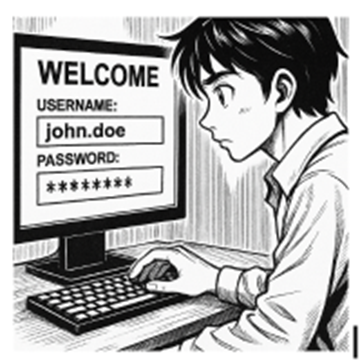

# 0226NF1.AA3: Gestor de contrasenyes

## Presentació de l'activitat

Alerta!! EverPia ha estat atacada per ciberdelinqüents. La consultora on esteu de becaris ha patit una fuita d’informació (data breach) i informació confidencial sobre un projecte que està en fase de desenvolupament està ara en mans de delinqüents que amenacen amb publicar-la si no es paga un rescat.
Òbviament, això ha causat una gran alarma dins la companyia i s’ha creat un comitè de crisi per gestionar la situació.

La investigació interna ha revelat que un dels comptes tècnics va ser compromès a causa de l'ús d'una contrasenya feble o reutilitzada.

Com a resposta a aquesta crisi, la Direcció Tècnica ha emès una directriu: tot el personal tècnic ha de començar a utilitzar un gestor de contrasenyes validat per garantir l'ús de credencials úniques i robustes. Se us encarrega la tasca d'avaluar les opcions i crear la documentació necessària per a la formació del personal.

### Durada de l'activitat

La durada de l'activitat és de 2 hores.

### Objectius de l'activitat

La finalitat d'aquesta activitat és que l'alumnat investigui i justifiqui la necessitat dels gestors de contrasenyes, comparant opcions basades en el núvol (online) i en escriptori (offline) i demostri coneixement de l'ús de l'eina escollida.

A més, com un objectiu secundari es vol treballar la capacitat per transmetre aquest coneixement en forma de documentació tècnica per la resta d’usuaris.

### Competències treballades

j) Elaborar documentació tècnica i administrativa del sistema, complint les normes i reglamentació del sector, per al seu manteniment i l’assistència al client.

l) Assessorar i assistir al client, canalitzant a un nivell superior els supòsits que ho requereixin per trobar solucions adequades a les necessitats d’aquest.

n) Mantenir un esperit constant d’innovació i actualització en l’àmbit del sector informàtic.

### Resultats d'aprenentatge i criteris d'avaluació

RA1. Aplica mesures de seguretat passiva en sistemes informàtics descrivint característiques d'entorns i relacionant-les amb les seves necessitats.

1.1 Valora la importància de mantenir la informació segura.
1.8 Valora la importància d'establir una política de contrasenyes.

### Continguts

Seguretat lògica: gestió de contrasenyes

### Capacitats clau

<table>
  <tr>
    <td>Autonomia</td>
    <td>Organització del treball</td>
  </tr>
  <tr>
    <td>Innovació</td>
    <td>Responsabilitat</td>
  </tr>
</table>

## Enunciat de l'activitat

### Fase 1: Anàlisi i Justificació (Document d'Informe)

Heu de redactar un informe que justifiqui tècnicament la decisió de la Direcció i comparin les opcions. Aquest informe ha d'incloure:

1. Introducció i Justificació:
    -Explicació de perquè les contrasenyes febles o reutilitzades són un risc crític per a l'empresa (atac de diccionari, credential stuffing, etc.).
    -La funció crucial d'un gestor de contrasenyes per mitigar aquests riscos.

2. Comparativa Tècnica: Realitzeu una taula comparativa detallada entre:
    -Bitwarden (Alternativa Online / Núvol): Analitzeu la sincronització, el model de seguretat (xifratge end-to-end), la facilitat d'accés des de múltiples dispositius i el cost/model freemium.
    -KeePassX / KeePassXC (Alternativa Offline / Escriptori): Analitzeu l'emmagatzematge local de l'arxiu (KDBX), la independència del núvol, el model open source i la portabilitat de l'arxiu.

3. Avantatges i Inconvenients: Resumiu els principals pros i contres de cada model (online vs. offline) des del punt de vista de seguretat, usabilitat i continuïtat del negoci.

4. Recomanació: Concloeu l'informe escollint l'eina que considereu més adequada per al personal tècnic de l'empresa i justifiqueu la vostra elecció.

### Fase 2: Guia d'Ús Tècnica (Manual Operatiu)

Utilitzant l'eina que heu seleccionat a la Fase 1 (Bitwarden, KeePassX, o similar), heu de crear una Guia d'Ús per a l'Equip Tècnic. Aquesta guia ha de ser clara i basada en captures de pantalla i instruccions pas a pas.

La guia ha de cobrir els següents punts obligatoris:

1. Instal·lació i Configuració Inicial: Descàrrega, instal·lació i creació de la BBDD principal o compte mestre.
2. Generació de Contrasenyes Segures: Explicació de com utilitzar el generador de contrasenyes de l'eina (paràmetres, longitud, caràcters especials).
3. Exemples d'Ús i Emplenament Automàtic:
   - Com desar una credencial d'un compte de correu electrònic.
   - Com desar una credencial d'una aplicació o servei web.
   - Com fer servir l’extensió del navegador per emplenar automàticament les dades.
4. Gestió de Còpies de Seguretat (Backup):
   - Explicació detallada de com fer una còpia de seguretat de l'arxiu de contrasenyes (KDBX en KeePass o Exportació en Bitwarden).
   - Recomanació de la millor pràctica per emmagatzemar aquesta còpia de seguretat de forma segura (clau USB xifrada o emmagatzematge xifrat al núvol).

### Entorn de treball

Per usar la versió instal·lable del gestor de contrasenyes es necessita una màquina virtual Windows 11. En el cas de KeePassXC existeix una versió portable que es pot executar sense instal·lació, però es recomana la versió instal·lable per a una millor experiència d'usuari.

### Documentació i Informe Final

Redacta un primer document amb la comparativa i la justificació tècnica de l'eina escollida. Posteriorment, redacta un segon document amb la Guia d'Ús Tècnica per a l'Equip Tècnic.

És important que els documents siguin clars, concisos i fàcils de seguir, amb captures de pantalla i instruccions pas a pas.

## Guia d'avaluació

|Criteri d'avaluació                                         | Ponderació| |
|------------------------------------------------------------|-----------|
| **Fase 1**                                                 |           |
| Justificació dels Riscos                                   |   10%     |
| Comparativa Tècnica                                        |   20%     |
| Conclusions                                                |   15%     |
| **Fase 2**                                                 |           |
| Instal·lació i Configuració Inicial                        |   10%     |
| Generació de Contrasenyes Segures                          |   20%     |
| Gestió de Còpies de Seguretat (Backup)                     |   15%     |
| **Documentació**                                           |           |
| Claredat i Concisió dels Documents                         |   10%     |

## Enllaços d'interès

1. [INCIBE: Gestión de contraseñas seguras](https://www.incibe.es/ciudadania/tematicas/contrasenas-seguras)

2. [Bitwarden: Password Manager](https://bitwarden.com/)

3. [KeePassX: Password Manager](https://keepassxc.org/)

4. [INCIBE: Gestores de contraseñas: qué son y cómo pueden mejorar la seguridad de las empresas](https://www.incibe.es/empresas/blog/gestores-de-contrasenas-que-son-y-como-pueden-mejorar-la-seguridad-de-las-empresas)
